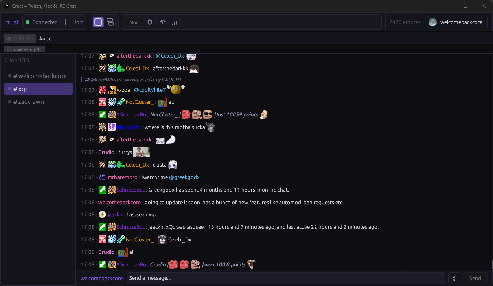
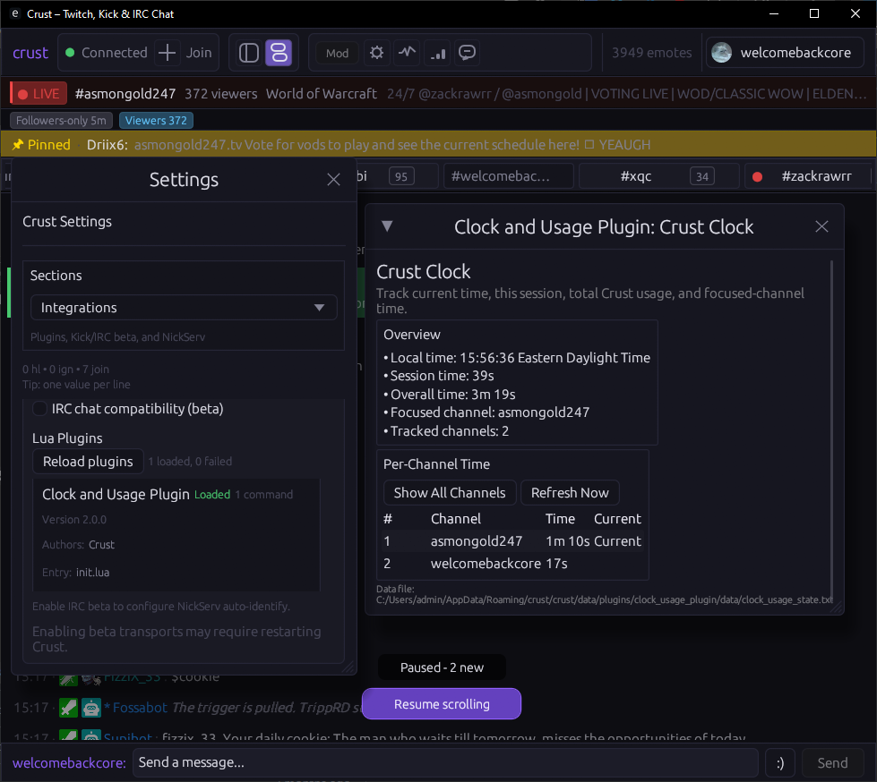
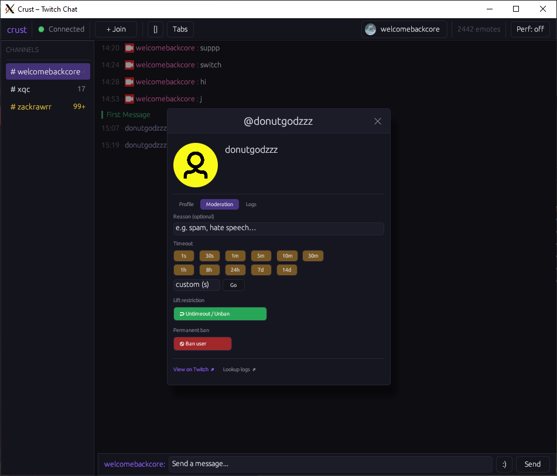
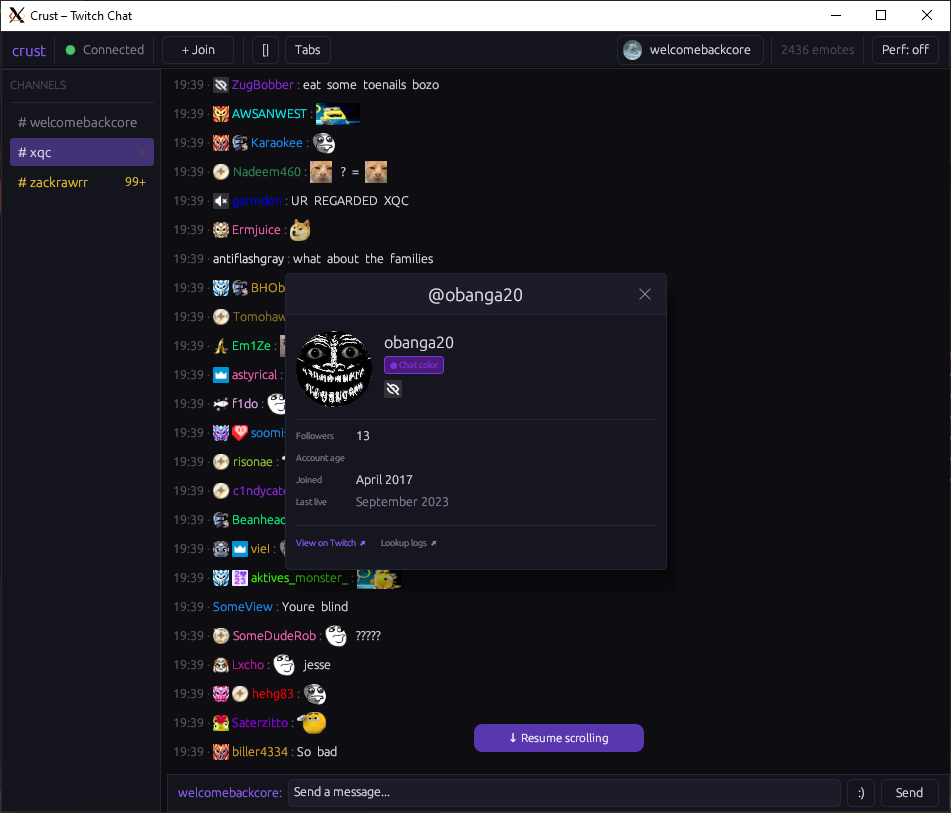
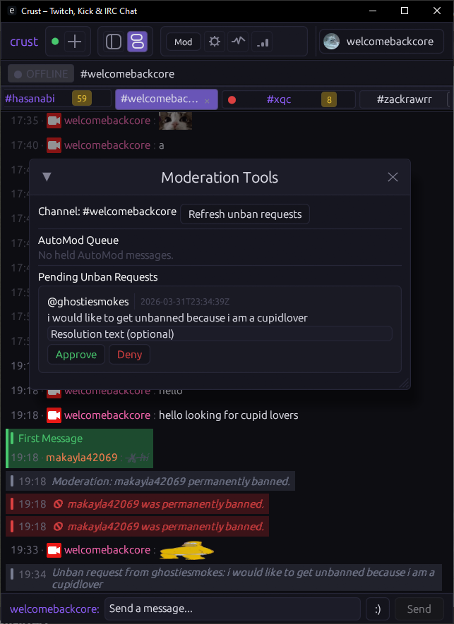

# crust

A native Twitch chat client written in Rust, with an `egui` desktop UI.

Crust is an early-stage hobby project. It supports multiple channels and accounts,
split chat panes, moderation tools, emotes, and Lua plugins. APIs and internals
may change. Kick support is incomplete and unstable; generic IRC support is also
in beta.

## Features

- Twitch chat over IRC/WebSocket, with anonymous reading and authenticated chat
- Tabs, a sidebar, up to four split panes, and a quick switch palette
- Twitch, BTTV, FFZ, and 7TV emotes, animated images, badges, and sender cosmetics
- Replies, whispers, search, local history, highlights, and notification sounds
- Moderation queues, user cards, polls, predictions, and channel-points tools
- Configurable shortcuts, command aliases, spellcheck, image uploads, and Streamlink integration
- Lua commands, event callbacks, plugin windows, and settings pages
- Update checks and installation support for Windows and Debian-based Linux

The [feature and keybind reference](docs/FEATURES_AND_KEYBINDS.md) describes these
features, their settings, and the available shortcuts and slash commands.

## Build and run

Install a stable Rust toolchain and Cargo. Linux builds also need the desktop and
WebKitGTK development packages listed in [Building Crust](docs/BUILDING.md).
Windows uses the WebView2 Runtime, which is included with Windows 11 and may need
to be installed on Windows 10.

From the workspace root:

```bash
cargo check
cargo run -p crust
```

See [Building Crust](docs/BUILDING.md) for release builds, Windows and Debian
packaging, WSL setup, and the workspace layout.

## Authentication

- Anonymous mode works for read-only chat.
- To send messages, log in with a Twitch OAuth token in-app.
- Multiple accounts are supported; switch accounts without restarting.
- Tokens use the OS keyring when available, with a settings-file fallback.

## Screenshots











## Documentation

- [Documentation index](docs/HOME.md)
- [Features and keybinds](docs/FEATURES_AND_KEYBINDS.md)
- [Chat behavior and performance audit](docs/AUDIT.md)
- [Plugin API reference](docs/API.md)
- [Example plugins](plugins/)
- [Release notes v0.5.1](docs/releases/Release_v0.5.1.md)
- [Release notes v0.5.0](docs/releases/Release_v0.5.0.md)
- [Release notes v0.4.9](docs/releases/Release_v0.4.9.md)
- [Release notes v0.4.5](docs/releases/Release_v0.4.5.md)

## Data paths

Crust uses platform-specific app directories from `directories::ProjectDirs`.
Typical Linux paths are:

- Config: `~/.config/crust/settings.toml`
- Cache: `~/.cache/crust/emotes/`
- Logs: `~/.local/share/crust/logs/`

## License

This project is licensed under GNU GPL v3.0. See [LICENSE](LICENSE).
