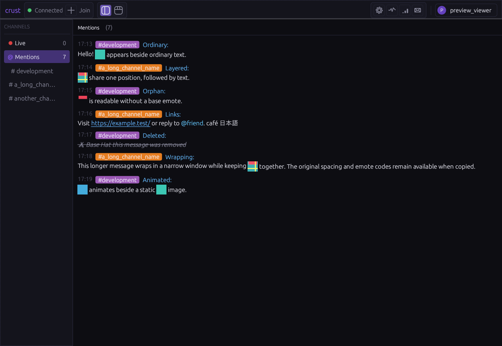
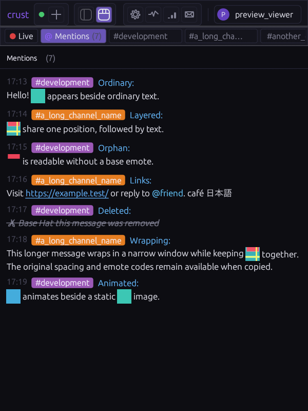
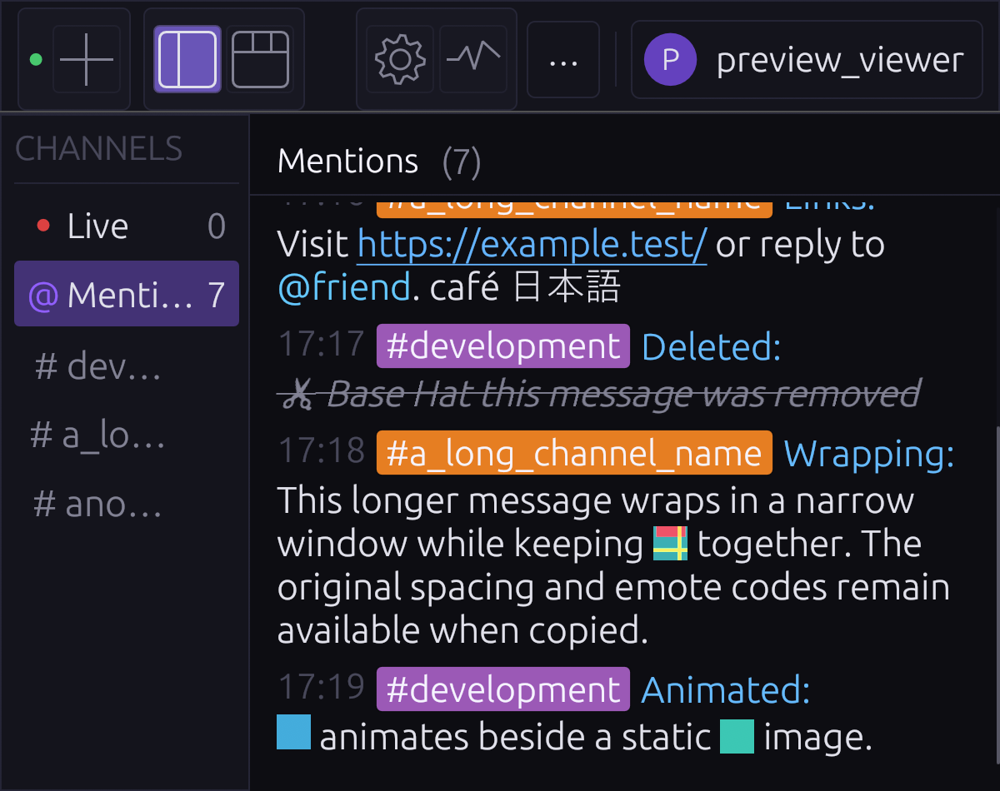
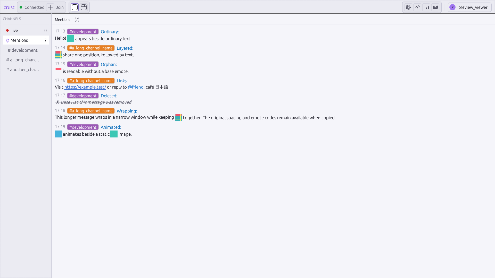
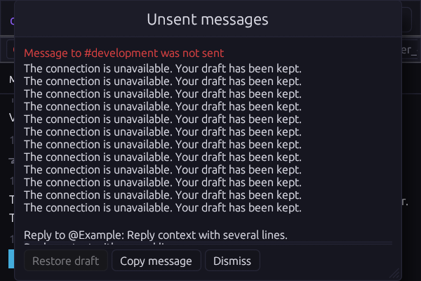
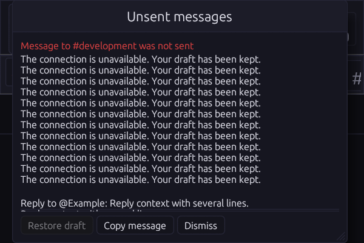

# Chat rendering, input, and saved layouts

This pass covered Mentions rendering, channel navigation, spelling suggestions,
phrase rules, saved layouts, and failed-message recovery. It continued the
startup and emote review after v0.5.6.

## Mentions and image loading

Mentions uses the same body renderer as channel chat. Ordinary emotes, layered
emotes, emoji, links, and action text follow the same rendering behavior.
Deleted messages retain their original text with a strikethrough and the shared
secondary text color, which stays readable in dark and light themes.

Clicking a message or emote opens its source channel. Links open their URLs.
The context menu copies the original text, including emote codes and whitespace.
Animation pause and hidden link previews follow the existing application settings.

The row-height cache includes parsed spans, deletion state, and image dimensions.
An emote catalog refresh or a completed image can therefore change wrapping in
an offscreen row without leaving stale scroll geometry. Measuring an offscreen
row reads cached dimensions without requesting or decoding its images. Visible
rows use the existing bounded cache and download queue; larger previews load
when hovered.

A focused benchmark in the Windows release build retained 2,000 Mentions rows
and rendered five visible rows. The ignored benchmark was run separately from
the workspace test suite.

| Layout path | Median | 95th percentile |
| --- | ---: | ---: |
| Full-row layout | 20.530 ms | 22.415 ms |
| Cached viewport layout | 0.699 ms | 0.970 ms |

Both paths use the current build. These timings compare cached viewport layout
with full-row layout; they do not measure a change between releases or
whole-application startup.

## Channel navigation and recovery

Sidebar rows use the same measured rectangle for painting, hit testing, and drag
placement. Labels and unread counts reserve separate space. The close button
uses the shared vector icon, and channel rows expose their names and selected
state to accessibility tools. Twitch live status stays scoped to Twitch channels.
Channel names and unread badges activate their row even when chat text selection
is enabled; decorative labels no longer intercept the click.

The top toolbar measures its labels and controls at the selected font size.
Account names fit a bounded button, with the full name available in a tooltip.
Actions that no longer fit remain available in the overflow menu. This corrects
the overlap reproduced with 24-point text and 150% UI scale.

Startup layout restoration normalizes saved channel IDs and excludes channels
that cannot join under the current configuration. Valid delayed joins still
restore. Split widths are applied after all panes exist, and filtering retains
the focused pane. Live and Mentions selections and split panes now survive a
save/restore round trip. Channel redirects update pending saved references as
well as the visible panes.

Explicit navigation, layout changes, and typing cancel an older pending restore.
The input check runs before the current frame's edits, including text, paste,
and IME composition. Automatic restoration preserves focus in other controls.

Failed-message recovery keeps long drafts, reply context, and error text in a
scrolling body with reachable recovery controls. Each queued message gets fresh
scroll and editor state. Pointer and keyboard checks preserve the full draft,
reply, and failure reason when copying or restoring.

## Spelling suggestions

Suggestions search dictionary entries of plausible lengths and use a bounded
edit check. They preserve insertions, deletions, substitutions, adjacent
transpositions, frequency ranking, keyboard proximity, phonetic fallback, and
custom words. Equal scores have a stable alphabetical order.

Suggestions are bound to their channel and exact draft. Replacement validates
that context and its UTF-8 range before changing text. Editing the draft or
switching channels invalidates stale choices. An interaction test also checks
that right-clicking a word corrects that word, preserves surrounding Unicode
text, and returns focus to the composer.

Five interleaved optimized-process samples on the Windows development machine
measured the following median suggestion-generation times. They exclude UI
painting and network work and do not measure whole-application startup.

| Input | Before | After |
| --- | ---: | ---: |
| `teh` | 3.599 ms | 1.126 ms |
| `recieve` | 15.501 ms | 7.756 ms |
| `fonetic` | 18.009 ms | 7.418 ms |
| `abotu` | 10.282 ms | 3.468 ms |
| 8-character unknown word | 23.802 ms | 7.321 ms |
| 16-character unknown word | 83.967 ms | 1.128 ms |
| 32-character unknown word | 373.828 ms | Below 0.001 ms measurement precision |

The matcher was also compared with generated one- and two-edit neighborhoods
for 132,253 query/candidate pairs. A 20,000-character unknown word and a correction
to a 64-character custom word cover long input without an arbitrary length cutoff.

## Phrase rules and native emotes

Case-insensitive literal rules preserve UTF-8 text around each match and use
Unicode case matching. Literal replacement strings keep characters such as `$1`
as text; regex rules retain capture expansion.

Raw live messages and remote history apply phrase rules before display and
persistence. Incoming whispers apply blocking and replacement before storage or
notifications. Sent whisper echoes and already-transformed local history keep
their stored text, so an expanding replacement does not repeat on every replay.

Replacing unrelated text preserves native emote IDs. Character offsets shift
with the replacement, including Unicode and regex expansion. An occurrence is
removed only when the edit overlaps its code. Mention-only rules also retain
their flag when ordinary name detection runs.

## Windows validation

The full release workspace suite finished with 1,309 tests passed, 16
intentionally ignored, and zero failures. The Clippy correctness gate passed
with warnings. The Windows v0.5.7 package build also passed.

The packaged candidate was checked with the saved account. Four channels
restored, saved Mentions displayed emotes, a pointer click on a channel name
selected its row, the emote picker showed 2,172 entries, and Settings opened and
closed. After a graceful close and restart, Mentions was still active, all four
ordinary channels were present, and restored emotes were visible.

## Native captures

These six captures use synthetic messages and placeholder emote artwork. They
contain no account data. The wide, narrow, scaled, and light Mentions views show
emotes and readable deleted rows. The scaled toolbar has separate controls, and
both short recovery windows keep their footer actions visible.

| Wide Mentions | Narrow Mentions |
| --- | --- |
|  |  |
| Scaled Mentions | Light Mentions |
|  |  |
| Short recovery window | Recovery with a larger chat-font preference |
|  |  |

The second recovery capture uses a larger chat-font preference. It does not
establish that the dialog font itself scales. The automated recovery UI tests
separately check the dialog with 24-point text.

## Startup observations and limits

Two saved-account runs recorded these elapsed UI-update samples:

| Run | UI updates | Median | 95th percentile | Maximum |
| --- | ---: | ---: | ---: | ---: |
| v0.5.6 baseline | 1,903 | 0.7494 ms | 1.7009 ms | 15.973 ms |
| Packaged v0.5.7 candidate, first session | 5,258 | 0.9851 ms | 1.2578 ms | 24.0632 ms |

Both runs restored four channels and recorded zero UI updates at or above
100 ms and zero event-limit overruns. The baseline reported no application
errors; the candidate log contained zero ERROR lines.

These elapsed UI-update measurements exclude event-loop waits and GPU
presentation. Traffic, cache state, and the views exercised differed between
runs, so neither sample is a controlled startup or release-speed comparison.
They do not explain the earlier isolated stalls.
[Issue #17](https://github.com/frankischilling/crust/issues/17) remains open until
a recurrence can be attributed and its cause verified.
