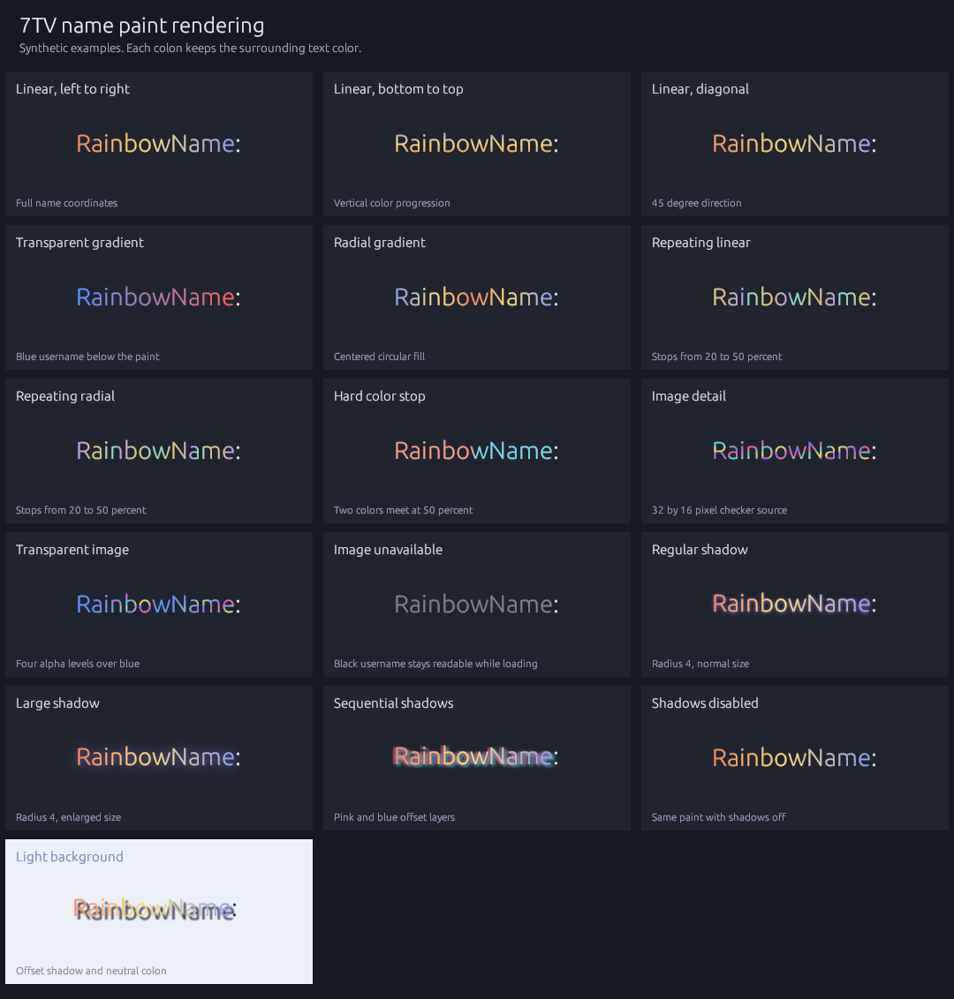

# 7TV paints, image loading, and chat controls

This review covers name-paint rendering and live updates, image work performed
during UI rendering, narrow split controls, sent-message history search, and
painted names in secondary message views. It accompanies v0.5.8.

## Rendering fixes

Ordinary chat passed no paint metadata to its sender-name renderer. The main
message path now supplies the sender's selected paint, as do Mentions and global
search. Reply previews, inline mentions, and received-whisper headers can resolve
known sender cosmetics through a shared lookup. Unknown senders keep readable
plain names until their appearance is available.

The renderer builds a coverage mask from the actual font glyphs, then samples the
paint for each covered pixel. This preserves image details and color boundaries
that were lost when a glyph's color depended only on its corners. The gradient
rectangle excludes preceding timestamps, badges, and the trailing colon.

Supported definitions include linear and radial gradients, repeating gradients,
hard stops, image paints, transparent colors, and sequential shadows. Paint
transparency blends over the sender's stored base color. Plain fallback text uses
the theme's contrast adjustment when an image is pending or its metadata is
invalid. Shadow-only paints remain usable.

Chat settings expose Show 7TV name paints, Show paint shadows, and Use larger paint
shadows. Turning off a parent option retains its child preferences. Image paints
use the existing animation preference. Lua callers can omit the three new
settings fields without resetting the user's saved choices.

Painted names retain text layout and accessible labels. Cached glyph masks,
shadows, and textures have a 32 MiB budget and a limit of 256 entries. At most
eight new names are rasterized per UI pass; names beyond that limit use readable
plain text and request another pass. An animated image updates its texture only
when the shared source frame changes.

The appearance lookup holds at most 2,048 identities and one current login alias
per identity. It shares paint allocations across reads. Live updates can arrive
before login registration, and explicit removals cannot be overwritten by an
older message snapshot. Renaming an account removes its old alias; an explicit
user ID never falls back to a different account with the supplied login.

## Live cosmetics

The live connection subscribes to room cosmetic and entitlement events as well
as emote updates. Paint and badge definitions can arrive before or after an
assignment. A late startup catalog preserves newer definitions received through
the socket. Removing an old entitlement leaves a different current selection
intact.

Live grants invalidate earlier profile generations, including grants that match
the current selection. This prevents a delayed HTTP response from replacing a
newer live choice. Duplicate events avoid redundant UI updates, and events from
older connection epochs are discarded.

Reconnect refreshes prioritize recent senders. A deduplicated queue retains at
most 2,048 users until their current profile succeeds. Each 250 ms tick offers
eight candidates to the existing scheduler, which allows 64 pending jobs and 20
HTTP requests. Each attempt chooses an available room, so closing a previous
request owner does not discard the underlying refresh.

If a live entitlement event invalidates an unfinished full profile, the queue
retries that profile. A sender who stops chatting can still receive the remaining
badge, avatar, color, and personal-emote data. An event that cancels no pending
profile adds no lookup, and existing reconnect work keeps its queue position.

## Image work

Image paints and paused emotes use the shared background decoder and its existing
memory, queue, and worker limits. The UI polls for completed pixels instead of
decoding the first frame inline. Still-image requests reserve the native decoder
output when it is larger than the eventual RGBA8 display image. Completion
releases the excess reservation.

These budgets cover retained pixel data and pending decoder reservations. Codec
workspace and temporary texture uploads contribute additional process memory.

The still-frame path can succeed when decoding a whole animation would exceed its
budget. Source replacement and eviction invalidate both animated and still-frame
variants. Canceled jobs stay charged until their work releases memory, and stale
results cannot replace newer images. Hidden views keep request deduplication and
failure cooldowns.

If the background decoder evicts a source before the outer cache does, loading
that source again rechecks the combined static and background image budget. The
outer entry returns to pending without dispatching a second copy of the job.

## Controls and secondary views

Split headers measure available space before showing inline controls. The menu
stays available as panes narrow; hidden actions remain in it. The title's context
menu has the same actions. The menu icon uses the shared vector style.

Ordinary and suspicious-user message bodies share the parent row's wrapping
area. A child layout had confined every body line to the width left after the
sender prefix, leaving long messages in a thin column. Continuation lines now
use the full message width. Measurement and drawing use the same renderer, and
regressions check cached row heights, painted prefixes, links, and context menus.

Ctrl+R opens an incremental search of the focused composer's sent-message
history. Searches handle Unicode text without changing the original saved
messages. Cycling wraps through matches. Accepting a result fills the composer
without sending it; canceling restores the draft. Switching channels clears the
search state, and another split cannot take its shortcuts.

Mentions keeps whole-row navigation and its message context menu when the sender
has a paint. Search results keep one keyboard target per result and wrap text
within the result row. Reply previews truncate long names within the pane and
reuse sender lookup indices across frames. Indices resolve current message data,
so paint changes do not leave copied styles behind.

Confirmed local echoes refresh the affected row and Mentions copy when Twitch
supplies a server ID, badges, or other sender metadata. Paired moderation notices
also invalidate the recent layout window when their content changes in place.

## Validation and measurements

The Windows release-mode workspace suite passed 1,378 tests with no failures, and
the correctness lint gate passed. Twenty benchmark or manual checks are excluded
from the standard run. The public catalog check, visual contact-sheet generator,
and two focused benchmarks below were run separately and passed.

The captured public 7TV catalog contained 1,068 definitions on November 15, 2026.
The parser accepted all 1,065 usable definitions: 656 linear gradients, 272 radial
gradients, and 137 image paints. This includes nine shadow-only paints. The three
remaining definitions were empty. No usable supported definition failed
deserialization or validation.

The visual contact sheet covers directions, transparency, radial and repeating
fills, hard stops, image detail, unavailable images, regular and large shadows,
sequential shadows, disabled shadows, and a light background. These are synthetic
examples rendered with the application's font glyphs.

### First-frame image work

Seven isolated samples used the same generated 1,024 by 1,024 PNG, encoded in
3,460,366 bytes. The synchronous path decodes and converts pixels on the calling
thread. The asynchronous path queues the shared decoder and returns pending.

| Measurement | Median |
| --- | ---: |
| Synchronous decode and conversion | 10.971 ms |
| First asynchronous UI poll | 0.073 ms |
| Completed background result | 11.860 ms |

The background path removes that decode work from the UI call. It does not make
the image finish decoding sooner, and these samples do not measure network
downloads or whole-application startup.

### Painted-name cache

An isolated egui pass drew 40 names using eight distinct labels and a gradient
with a shadow. Font initialization happened before timing. Eleven cold passes
and 220 cached passes produced these results:

| Pass | Median | 95th percentile |
| --- | ---: | ---: |
| Cold painted names | 1.499 ms | 2.091 ms |
| Cached painted names | 0.044 ms | 0.057 ms |

The cache retained eight names, estimated at 108,560 bytes, and the cached passes
performed no new name builds. This is CPU-side layout and raster work in a test
context; it does not include native window presentation or GPU timing.

### Native startup observation

The final Windows release build was observed for 180 seconds with the saved
account and four saved chats. Three rooms confirmed authenticated joins; an
account restriction prevented the fourth. No account or room identifiers are
included here.

| Logged milestone | Time from process start |
| --- | ---: |
| EventSub connected | 0.285 s |
| First UI update | 0.318 s |
| Webview initialized | 0.502 s |
| IRC authenticated | 0.694 s |
| 7TV cosmetics catalog received | 1.638 s |

The observation recorded 480 UI updates. Their median duration was 0.756 ms,
the 95th percentile was 2.095 ms, and the longest was 7.115 ms. No logged update
reached 100 ms, and the logs contained no panic markers. The process reported
responding at all four samples:

| Elapsed time | Working set | Private bytes | Cumulative CPU time |
| --- | ---: | ---: | ---: |
| 3.220 s | 339.0 MiB | 294.9 MiB | 0.297 s |
| 20.233 s | 330.7 MiB | 291.2 MiB | 1.875 s |
| 60.198 s | 325.1 MiB | 278.1 MiB | 1.953 s |
| 180.167 s | 327.9 MiB | 281.2 MiB | 2.203 s |

This was one observational run with uncontrolled network and cache state. Logged
milestones do not establish when every emote became ready, and UI-update durations
exclude native presentation and GPU timing. These results establish neither a
controlled startup speedup nor a fix for the intermittent stalls in issue #17.

### Native interface checks

An earlier candidate build was exercised with the saved account. Live chat showed
painted sender names and matching inline mentions alongside badges and emotes.
The paint setting disabled its child controls while retaining their checked
values; restoring it restored the controls. The composer context menu opened
input-history search, and Cancel returned to the composer without sending.

Four panes in an 840-pixel-wide window kept their options buttons visible. The
menu opened channel search in its separate window and closed the other panes.
The original single-pane layout, window bounds, and paint preferences were
restored after the checks.

The final build's 180-second capture was also inspected. An additional multi-pane
check stopped before input because Windows refused foreground focus, so final
native verification of that layout remains incomplete. The body-wrapping change
passed two focused regressions and the full workspace suite.

## Remaining feature work

The broader comparison confirmed several missing features. They are tracked in
[issue #37](https://github.com/frankischilling/crust/issues/37):

| Area | Current limit | Remaining behavior |
| --- | --- | --- |
| Layouts | Up to four horizontal panes in one main window | Nested horizontal and vertical containers, plus detached chat windows |
| Pane state | Filters and search belong to a channel | Independent filters and searches for repeated views of the same channel |
| Recovery | Closing a pane removes it | A bounded reopen history with its draft and view state |
| Overlay | No transparent chat viewport | Transparent presentation with explicit interaction and click-through modes |
| Replies | Parent previews and navigation | A thread viewer, composer, and subscription controls |
| Search and user cards | Search snippets and user-card logs use simplified body text | Ordinary message rendering with emotes, badges, reply context, and event rows |
| Shortcuts | Window, tab, split, and moderation categories | Rebindable composer actions in an input category |

The 7TV worker also uses one connection's subscription budget. Large combinations
of rooms and personal sets can exceed that budget; broader live coverage is
tracked in [issue #38](https://github.com/frankischilling/crust/issues/38).

[Issue #17](https://github.com/frankischilling/crust/issues/17) remains open for
occasional long UI updates observed in earlier runs. A short run without a stall
does not establish that its cause has been removed. This review does not establish
complete feature or visual parity across every application surface.
