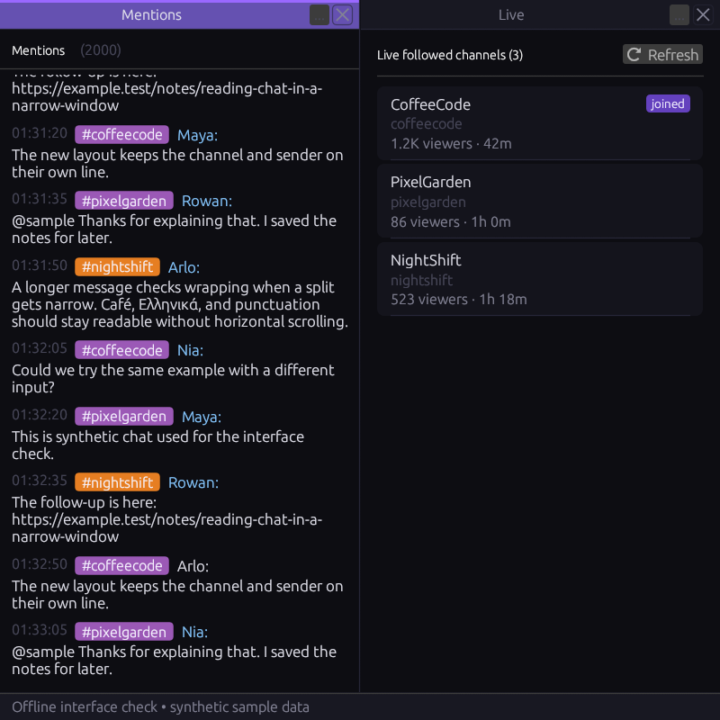

# Chat cards, Mentions, and badge loading

This pass fixes stale results in user cards, missing split controls, repeated
Mentions layout work, and badge requests that outlive their account. It also
keeps saved credentials out of settings diagnostics.

[User cards](../crates/ui/src/widgets/user_profile_popup.rs) accept external logs
only when the user, channel, and request generation still match the open card.
Closing and reopening a card or starting another refresh invalidates earlier
results. A full command queue or a lost runtime ends the loading state with an
error and allows a retry. Plugin requests remain available; results without a
card request ID cannot overwrite the card.

The [split header](../crates/ui/src/widgets/split_header.rs) now appears on Live
and Mentions panes. Both have readable titles and the same close controls as
other panes. Closing one preserves the remaining chat and its draft. Search
controls are omitted from these views because they have no channel search.

The [Live feed](../crates/ui/src/widgets/live_feed.rs) also adapts to narrow
panes. Viewer counts and uptime move below the login, and thumbnails shrink or
disappear as space runs out. Joined status has reserved space beside the name.
Long labels truncate within their own bounds; names and logins share a left
edge, while wide rows keep right-aligned metadata. Refresh gets space before
the header title is laid out. Font line heights determine the row height, so
larger text stays within a row and scrolling keeps a consistent extent.

[Mentions](../crates/ui/src/widgets/mentions.rs) caches measured row heights and
skips layout for unchanged rows outside the viewport. Visible rows still use
current colors and moderation state, and their channel pills still open the
source message. Width, text, timestamp options, style, and font changes
invalidate the affected measurements. Font checks compare shared font identities
without scanning font data on every frame.

The cache holds at most five views, so replacing panes cannot leave an unlimited
collection of old row caches in UI memory. Each view removes rows that have left
the mentions buffer. The render path still scans and compares retained messages
on every frame, so that work remains linear in the buffer size. A cold cache or
a layout change measures the full buffer. The benchmark below measures the
savings once the cache is warm.

The [shared color parser](../crates/ui/src/theme.rs) reads hexadecimal bytes
without slicing arbitrary text at UTF-8 boundaries. Malformed Unicode values
therefore produce a parse failure instead of a panic. Callers retain their
existing RGB, RGBA, alpha, and whitespace rules.

[Settings diagnostics](../crates/storage/src/settings.rs) use an explicit list
of safe fields, including feature flags, layout values, and counts. Tokens and
freeform values such as account labels, headers, paths, and commands are omitted.
The crash snapshot API accepts settings directly and builds this summary.
Malformed settings reports retain the error location without including source
text or a rejected value. Settings serialization and persistence are unchanged.

[Badge loading](../crates/app/src/runtime/badges.rs) reuses one HTTP client and
takes credentials from the current validated account. It no longer validates
the token separately for each badge load. Authorization headers belong to Helix
requests and are absent from public fallback requests. Permanent client errors
stop retrying that URL; timeouts, rate limits, transport failures, and server
errors retain bounded retries.

The [runtime](../crates/app/src/main.rs) owns both channel and global badge work.
Account changes, logout, disconnect, and revoked authentication cancel pending
loads. A new global refresh replaces the previous task, and dropping its owner
also cancels it. Bundled global badges are loaded once during startup. Later
refreshes spawn network work without reparsing the bundle in the chat reducer.

The regression coverage checks the following behavior:

| Area | Cases covered |
| --- | --- |
| User cards | Different users and channels, closed and reopened cards, superseded requests, duplicate results, missing request IDs, rejected dispatch, and runtime loss. |
| Split controls | Actual close button and menu interaction on Live and Mentions, preservation of the other pane and draft, and absence of unsupported search actions. |
| Live feed | Painted text bounds and alignment at narrow widths and larger fonts, row opening, Refresh, player menu actions, and image requests only for visible thumbnails. |
| Mentions | Cached and full layouts at several widths and scroll positions, changed text and names, font and style changes, current row colors, click targets, pruning, and repeated pane replacement. |
| Color parsing | Valid RGB and RGBA values, alpha rules, malformed input, and Unicode values that previously crossed byte boundaries. |
| Diagnostics | Synthetic secrets and freeform settings, safe diagnostic fields, settings round trips, and malformed TOML without source disclosure. |
| Badge loading | HTTP connection reuse, changed account credentials, public fallback headers, permanent and transient errors, and cancellation on replacement, clear, and drop. |

Validation results:

| Check | Result |
| --- | --- |
| Full UI suite | 354 passed, four ignored benchmarks. |
| Release workspace suite | 1,127 passed, 14 manual performance or soak checks ignored. Run with `cargo test --workspace --all-targets --release --locked --offline --no-fail-fast`. |
| Correctness linting | Passed with `cargo clippy --workspace --all-targets --release --locked --offline -- -A clippy::style -A clippy::complexity -D clippy::correctness`. Existing advisory warnings remain. |
| Release build | Both the application and webview host built successfully for Windows. |
| Desktop checks with the saved account | Authenticated successfully, restored four channel tabs, displayed live chat and emotes by the three-second capture, and remained responsive at three, 20 and 60 seconds. |

Native widget captures cover wide and narrow panes at 100% app zoom and a
further view at 150% zoom. The narrow capture below uses synthetic data. The
[earlier layout](./images/stability-live-narrow-before.png) let joined status
cover part of the viewer count; the compact rows keep both readable.

The ignored `mentions_cached_viewport_benchmark` compares full row rendering
with the cached path using 2,000 messages, a 480 by 320 point viewport, and a scroll
offset of 6,000 points. Each path gets three warm-up frames and 31 measured
frames. Every measured pair also checks matching layout. This measures warm
egui rendering with synthetic wrapped messages, excluding GPU presentation and
network work. It does not measure the frame rate of the whole application.

| Measurement | Result |
| --- | --- |
| Build and machine | Commit `958786f`, release profile, Rust 1.98.1, Windows 11 Pro 10.0.22621, Intel Core i7-13700H. |
| Scale | Headless benchmark at one pixel per point. Native visual checks use 125% desktop scaling, with 100% and 150% app zoom. |
| Full rendering: median and p95 frame time | 12.843 ms median; 14.115 ms p95. |
| Cached rendering: median and p95 frame time | 0.460 ms median; 0.595 ms p95. |
| Retained rows and rendered rows | 2,000 retained; five rows rendered in the warm viewport. |
| Startup observation | Existing account and disk caches, four restored tabs, three join acknowledgements within 0.961 seconds. A window handle appeared at 0.139 seconds; the first screenshot at three seconds confirmed populated chat. The status strip was visible at 20 seconds and gone at 60 seconds. Complete provider-catalog readiness was not separately timed. |
| Visible assets | Chat emotes and badges rendered in the three-second screenshot. The first minute recorded 59 texture uploads. |
| UI update time in the first minute | 586 samples: 0.729 ms median, 1.867 ms p95, 8.901 ms maximum; no update reached 100 ms. This excludes GPU presentation and event-loop waits. |
| Process resources at 60 seconds | Approximately 339 MiB working set, 298 MiB private memory, and 1.375 cumulative CPU seconds. |

The desktop observation used commit `28e2a40`, before the packaging version bump,
with the existing account and caches. It is not a cold-cache comparison. The
active chat retained 1,500 messages and rendered at most 40 rows per update.
Raw account logs and screenshots are kept out of this report; the images above
contain synthetic data.

[Issue #17](https://github.com/frankischilling/crust/issues/17) remains open.
Resolution of that report is unverified; its original reproduction still needs
a separate check.
