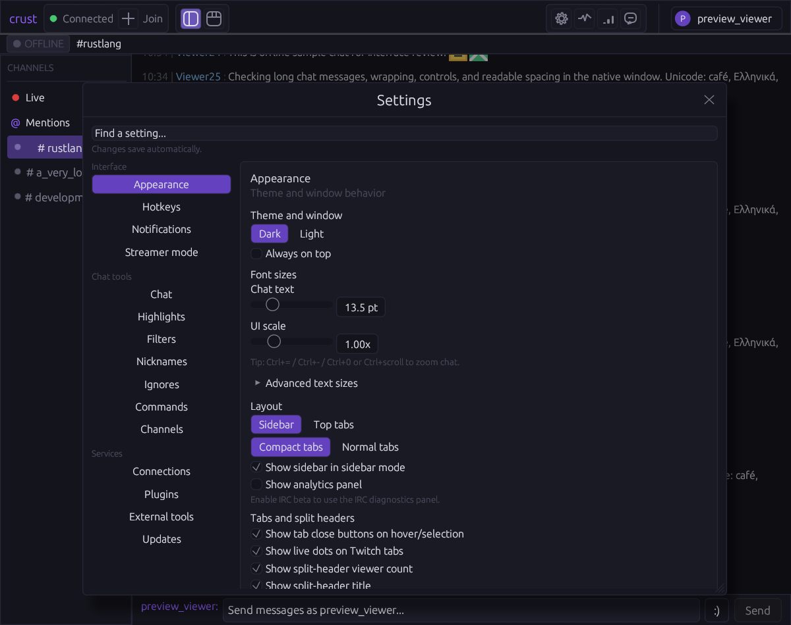
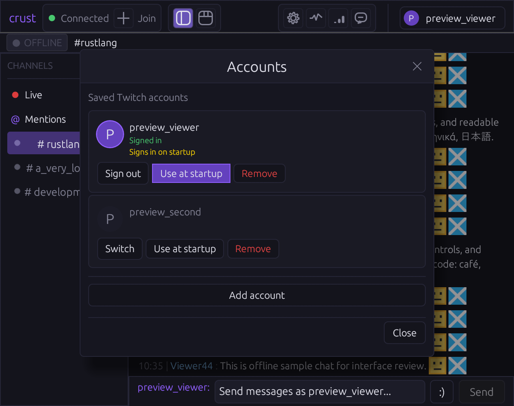

# UI, chat workflows, and performance

Date: 2026-11-14. Baseline: `7d68f63` (v0.5.3).

This pass covers the desktop interface, account and channel emote ownership,
provider refreshes, and work performed during a UI update. It continues the
[startup audit](AUDIT_STARTUP.md). The related tracking items are
[settings and UI](https://github.com/frankischilling/crust/issues/14),
[remaining emote scopes](https://github.com/frankischilling/crust/issues/9), and
[long UI updates](https://github.com/frankischilling/crust/issues/17).

## Interface and keyboard behavior

Settings now has searchable, grouped navigation and fifteen focused pages.
Connections, Plugins, External tools, and Updates have their own pages. The
compact layout uses a page selector. Each page retains its own scroll position,
and fields retain their identity when the window changes between layouts.
Searching supports keyboard selection and Escape without changing an unrelated
setting. Advanced text-size overrides are collapsed initially so the main font
and layout controls are easier to reach.

Highlight and filter rules use responsive editors. Reorder, duplicate, remove,
mode selection, and validation remain available in narrow windows. The expression
editor keeps Save and Cancel outside its scrolling body, focuses the editor once
when opened, validates the current draft, and inserts palette tokens at the
selected Unicode character range. Old parser spans cannot split a new UTF-8
character. While the editor is open, application shortcuts do not close a chat
or open another palette; Escape dismisses the editor before underlying chat
popups. Closing Settings discards the unfinished expression draft.

Accounts separates identity and status from actions. Saved accounts scroll
inside the dialog while Close remains visible. The startup-account action has a
text label, and removing an account requires an explicit second action that can
be cancelled. Every close path clears the token field. Account controls retain
stable IDs as the list changes.

The toolbar sizes its action group to the actual controls. It no longer draws a
wide empty outlined group or labels the image-cache entry count as an emote
inventory. Tabs and Settings use clearer vector icons. Diagnostics remain in
the Performance overlay.

The composer keeps the emote picker accessible in a 150-point pane. The username
and Send button yield space before the text field becomes cramped; Enter still
submits a valid draft. When the Twitch character count will not fit beside the
input, it gets a separate row. Single-chat and split-pane trays use the same
height calculation, including over-limit drafts.

The picker removes the duplicate heading and uses one menu for provider order.
Its window is constrained to the viewport. The default All view places unused
chat emotes before unused emoji, while search matches, favorites, explicit
provider preference, usage, and recent selections retain their priority.
Provider tabs, their shortcuts, favorites menus, and caret insertion remain.

Replacing a split's channel keeps the text and selection attached to that pane,
matching the single-pane composer. A reply remains tied to its original channel
and cannot attach to a message in the replacement channel.

Analytics invalidates its cache on channel identity changes, including platform
changes with the same display name. Snapshots carry that identity and use it for
their filename. Reset applies only to the current channel and recomputes in the
same frame; it no longer leaves a missing cache to be unwrapped. A late profile
response cannot reopen a card that was dismissed while loading.

Search consumes Escape only when its controls own keyboard focus. Accounts,
Join, Settings, and the chat composer retain their own Escape behavior.
Moderation shortcuts require an expanded, active window at the front of the
interactive window stack. Clicking chat relinquishes that ownership, and a
focused text field keeps its text-entry and Tab behavior. J/K navigation and
bulk actions use the same filtered queue; hidden entries cannot shift the
selection onto a different user.

Whispers has a recipient composer that works without an open Twitch channel.
Each recipient keeps a separate draft. A draft remains available until its
matching successful send response; a later failure cannot replace newer text.
Recovery requires a recorded attempt for the current account and recipient,
including attempts made with `/w`. Changing accounts clears private composer
state. In a narrow window, the recipient selector sits above history and the
composer remains visible.

At most 32 outgoing whisper jobs are retained. Results belong to the account
lifetime that started them. The reducer publishes outcomes in order with account
changes, including when the UI event queue is full. An old result cannot consume
a fresh attempt after switching away and back to the same account, even when
the recipient and message body are identical.

User cards have a bounded scrolling body. Long descriptions, shared-channel
lists, and full moderation controls stay reachable in short windows, while the
title-bar close control remains visible. Long display names and metadata wrap.

### Native interface captures

These captures use the production UI with synthetic messages and accounts.





## Twitch follower inventory

Account inventory and follower inventory share a four-request budget. Joined
Twitch rooms obtain follower emotes with the account inventory endpoint's
channel parameter. Follower definitions carry both the account's immutable user
ID and the channel ID. The picker, autocomplete, message tokenization, and local
outgoing ranges use that same ownership rule.

A follower emote cannot leak into another channel, another account, or a
whisper. Account-wide emotes remain available outside the follower channel.
Native positions supplied with an incoming Twitch message remain authoritative.
Unicode positions for outgoing messages count characters, not UTF-8 bytes.

The extra channel query reads the first page, where follower emotes are supplied;
ordinary account inventory retains pagination. A successful empty response
removes old follower definitions. Failed, cancelled, or obsolete requests cannot
replace a usable inventory. Account changes, scope loss, room changes, and
leave/rejoin invalidate the appropriate requests. Chat still works without the
optional `user:read:emotes` permission.

## Provider changes and cached snapshots

The existing 7TV socket now watches global and selected personal sets as well as
joined channel sets. Personal subscriptions retain the sender's ownership and
follow membership changes. A membership change that arrives during a metadata
request schedules a follow-up after that request completes. Reconnects use the
existing acknowledged-subscription and snapshot reconciliation path.

Cached responses must not undo changes already received from the live service.
This applies both to an emote's contents and to the identity of the active set.
Up to 64 recently retired set IDs, including the absence of a set, are retained
for up to thirty minutes. A cached response cannot silently restore one
of those retired sources. Fresh authoritative metadata may intentionally
restore it. An authoritative empty personal set remains empty through repeated
cached profile responses, even after its empty map has been removed.

Global BTTV, FFZ, and 7TV metadata refreshes every five minutes. Concurrent manual
and periodic global loads coalesce. A provider failure preserves its last usable
catalog. Valid empty inventories remain distinct from failures, while live
reconciliation prevents a stale empty snapshot from overriding recent
authoritative state. Refreshing metadata does not prefetch every image. FFZ
globals use the five-minute refresh; FFZ channel metadata loads when joining or
manually refreshing a room. This release does not add an FFZ event feed.

Live snapshots retain a four-request limit per provider. Account and follower
inventory share a separate four-request limit.
Personal discovery admits at most 64 queued or running jobs, counting obsolete
jobs until they exit. The selected personal inventory retains the existing
256-emote per-user and 16,384-emote total bounds. These are limits on individual
subsystems, not a claim that the entire application has four network requests.

Personal discovery uses the first flagged personal set for each sender; it does
not aggregate multiple personal sets. Up to 64 personal live scopes are proposed,
subject to the provider's subscription limit and channel/account priority.
Membership changes also reconcile during five-minute snapshots.

Ordinary channel refreshes coalesce while the same room is already loading.
Twitch and Kick share four active provider groups, with up to twelve ordinary
provider requests in flight. Waiting groups check the channel lifetime again
after acquiring a permit. Leaving or reconnecting a queued room prevents its
obsolete group from starting network work. A held-provider regression exercises
six channels and 384 repeated forced refresh attempts.

## Animation decoding

Previously, requesting the first GIF or WebP frame could decode every frame on
the UI thread while holding the image-loader lock. A two-worker shared queue now
performs that decoding in the background. The first request returns pending and
the completed job requests a repaint.

The queue accepts at most 32 waiting jobs. Encoded-source requests deduplicate,
and decoded-byte reservations cover waiting jobs, running jobs, and retained
frames. Forgetting or replacing an image invalidates its old result. A cancelled
job keeps its reservation until it exits, so repeated replacements cannot evade
the budget. Full queues retry later without blocking the UI. Still WebP images
have a separate single-frame path.

These budgets cover retained image data and reservations. They do not describe
total process memory or every temporary allocation inside a decoder.

### Before and after

Measurements used release-profile Windows tests on an Intel Core i7-13700H,
with Rust 1.98.1. The same generated 112 × 112 GIF contains 120 frames and
698,963 encoded bytes. Each run used seven fresh egui contexts.

| Measurement | Previous synchronous path | Background path |
| --- | ---: | ---: |
| Median first UI call | 12.948 ms | 0.0415 ms |
| First-call range | 12.180–15.464 ms | 0.0346–0.2196 ms |
| Median complete decode | 12.948 ms | 13.205 ms |

The first call blocks about 312 times less. Complete decoding takes comparable
time; the improvement comes from moving that work away from the UI thread.

```bash
cargo test -p crust-ui --lib --release --locked perf_animation_cold_load -- --ignored --nocapture --test-threads=1
```

### Four populated panes

The separate headless workload uses four production message panes at 1280 × 800.
Each pane retains 5,000 text messages. Each phase measures 120 frames; append
phases insert ten messages per channel before rendering. The final run used the
compiled test binary with no Cargo or rustc process running.

| Workload | Median | p95 | Maximum | Rendered rows |
| --- | ---: | ---: | ---: | ---: |
| Warm repaint | 0.724 ms | 0.946 ms | 1.404 ms | 96 |
| Live append | 0.876 ms | 1.177 ms | 1.680 ms | 96 |
| Live append, one pane paused | 1.171 ms | 1.515 ms | 1.764 ms | 101 |

The panes retain 20,000 messages and keep 1,600 rows in their active windows.
These are absolute rendering measurements, excluding network processing, event
ingestion, and GPU presentation. They are not a before/after comparison or a
claim about sustained messages per second on the network.

```bash
cargo test -p crust-ui --lib --release --locked perf_four_channel_backlog -- --ignored --nocapture --test-threads=1
```

## Diagnosing long updates

The Performance overlay separates UI update duration from repaint rate and
repaint intervals. Waiting for the next event during idle chat is no longer
presented as slow rendering. Retained rows count the physical message buffers;
eligible rows count the rows remaining after filters and pause snapshots.
Active and rendered rows describe the smaller rendering workload.

`crust_ui::timing` records elapsed phases for image admission, setup, event
handling, emote backfill, maintenance, dialogs, navigation, chat, overlays,
image cleanup, and finalization. It also records event backlog, backfill work,
history and rendering counters, pending decodes, completed decode work, and
texture submission work. Updates above `CRUST_SLOW_FRAME_MS` produce warnings;
the default threshold is 100 ms. Ordinary updates are available at debug level:

```powershell
$env:RUST_LOG = 'info,crust_ui::timing=debug'
$env:CRUST_SLOW_FRAME_MS = '100'
.\target\release\crust.exe
```

Phase durations exclude event-loop waits and GPU presentation. Background decode
time is counted when a job finishes and can include work begun during earlier
frames. Texture-upload timing measures CPU submission to egui, not GPU completion.

The historical 337 ms elapsed update in issue #17 remains unattributed. The
animation benchmark demonstrates a separate reproducible cost; it does not
establish the cause of that earlier observation. The new phase and workload
counters make a recurrence easier to diagnose.

## Verification

The unchanged baseline passed 1,039 release-profile workspace tests, with eleven
ignored benchmark or soak tests. New regressions cover account/channel follower
ownership, stale snapshots, personal membership changes, background image
loading, settings and expression-editor input, account removal, and narrow
composer interaction.

The final Windows workspace run passed 1,104 tests, with thirteen ignored
benchmark or soak tests and no failures. The UI suite accounts for 339 passing
tests; the application/runtime suite accounts for 254.

| Area | Verified behavior |
| --- | --- |
| Navigation and splits | Stable pane identities, independent scroll state, channel replacement, draft/selection retention, reply scope, quick switch, and responsive toolbar controls |
| Chat input and picker | Narrow-pane access, Unicode limits and selections, caret insertion, completion, provider ordering, and rejected-send recovery |
| Settings and dialogs | All settings pages, per-page scrolling, field identity across resize, rule-editor actions, modal keyboard ownership, account removal, and token clearing |
| Search and moderation | Focused Escape handling, active-window shortcut ownership, text-editor exclusion, filtered J/K selection, and action targeting |
| Whispers | Reply without a channel, recipient drafts, queued and failed sends, account changes, identical retries across account lifetimes, and private error placement |
| Profiles and analytics | Late-response dismissal, short/narrow card scrolling, moderation confirmation/cancel, channel-specific cache/export, and Reset |
| Emote metadata | Account/channel ownership, generation checks, live changes and reconnects, cached snapshots, successful empty results, coalescing, and bounded work |
| Images and rendering | Background decode admission, cancellation and stale results, byte accounting, visible-row work, paused panes, and phase timing |

Offline native fixtures exercise the production UI with synthetic messages and
images at wide, narrow, and 1.5× enlarged layouts. Saved-account desktop checks
exercise actual authentication, channel connections, history, provider loading,
and live chat rendering. Network sends and destructive moderation use automated
coverage; reading real chat does not verify server acceptance of a sent message.

The final integrated gate uses:

```bash
cargo test --workspace --all-targets --release --locked --no-fail-fast
cargo clippy --workspace --all-targets --release --locked -- -A clippy::style -A clippy::complexity -D clippy::correctness
```
